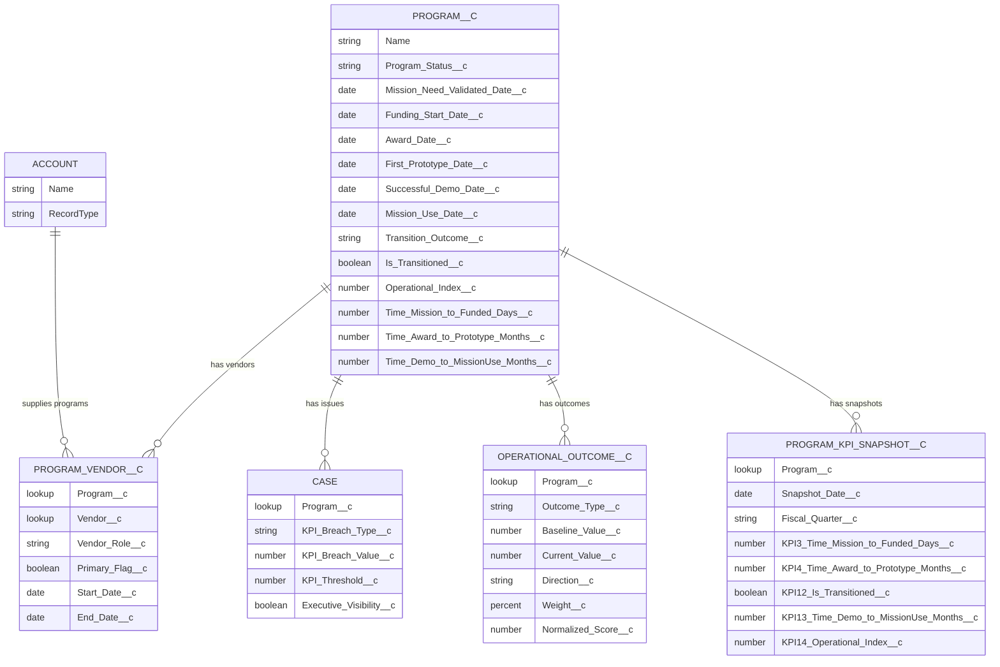

# Portfolio Manager Object Model

## Scope Source

This object model is based on the original requirements:

- Primary object is **Program**
- Program is tied to **Accounts (Vendors)** and **Case**
- KPI framework maps to Salesforce objects/fields
- Executive dashboard outcomes required for:
  - Time from Mission Need to funded start
  - Time From Award to first relevant prototype
  - Prototype to transition conversion rate
  - Operational Index

## Conceptual Model

```text
Account (Vendor)
   ^
   | (Lookup)
Program_Vendor__c (junction)
   | (Master-Detail / Lookup)
   v
Program__c --------------------< Case (Lookup Program__c)
   |
   | (Master-Detail)
   +----< Operational_Outcome__c
   |
   | (Lookup)
   +----< Program_KPI_Snapshot__c
```

## Mermaid ER Diagram



## Object Definitions

### 1) `Program__c` (Primary)

Purpose:
- Central portfolio record for mission, funding, prototype, transition, and operational KPI tracking.

Key fields:
- `Program_Status__c` (Picklist)
- `Mission_Need_Validated_Date__c` (Date)
- `Funding_Start_Date__c` (Date)
- `Award_Date__c` (Date)
- `First_Prototype_Date__c` (Date)
- `Successful_Demo_Date__c` (Date)
- `Mission_Use_Date__c` (Date)
- `Transition_Outcome__c` (Picklist)
- `Is_Transitioned__c` (Formula Checkbox)
- `Operational_Index__c` (Number)

KPI formulas on Program:
- `Time_Mission_to_Funded_Days__c`
- `Time_Award_to_Prototype_Months__c`
- `Time_Demo_to_MissionUse_Months__c`

### 2) `Account` (Standard, Vendor record type)

Purpose:
- Master record for external vendors/suppliers/partners attached to Programs.

Pattern:
- Use standard `Account` with a Vendor-focused record type.

### 3) `Program_Vendor__c` (Junction)

Purpose:
- Supports many-to-many relationship between Programs and Vendor Accounts.

Relationships:
- `Program__c` -> `Program__c` (Master-Detail recommended)
- `Vendor__c` -> `Account` (Lookup)

Suggested attributes:
- `Vendor_Role__c`
- `Primary_Flag__c`
- `Start_Date__c`, `End_Date__c`

### 4) `Case` (Standard + Program lookup)

Purpose:
- Tracks risks/issues/escalations tied to program execution and KPI breaches.

Relationship:
- `Case.Program__c` (Lookup to `Program__c`)

Suggested KPI breach fields on Case:
- `KPI_Breach_Type__c`
- `KPI_Breach_Value__c`
- `KPI_Threshold__c`
- `Executive_Visibility__c`

### 5) `Operational_Outcome__c` (Child of Program)

Purpose:
- Captures measurable mission impact dimensions used to compute Operational Index.

Relationship:
- `Program__c` -> `Program__c` (Master-Detail)

Key attributes:
- `Outcome_Type__c`
- `Baseline_Value__c`
- `Current_Value__c`
- `Direction__c` (Higher Better / Lower Better)
- `Weight__c`
- `Normalized_Score__c`

### 6) `Program_KPI_Snapshot__c` (Periodic KPI fact)

Purpose:
- Time-based fact table for monthly/quarterly trend analytics and executive dashboards.

Relationship:
- `Program__c` (Lookup)

Snapshot attributes:
- `Snapshot_Date__c`
- `Fiscal_Quarter__c`
- KPI value fields for dashboard trending

## Logical Relationship Cardinality

- `Program__c` 1 -> many `Program_Vendor__c`
- `Account` 1 -> many `Program_Vendor__c`
- `Program__c` 1 -> many `Case`
- `Program__c` 1 -> many `Operational_Outcome__c`
- `Program__c` 1 -> many `Program_KPI_Snapshot__c`

## KPI-to-Object Mapping

- **Time from Mission Need to funded start**
  - Object: `Program__c`
  - Input fields: `Mission_Need_Validated_Date__c`, `Funding_Start_Date__c`
  - Derived field: `Time_Mission_to_Funded_Days__c`

- **Time From Award to first relevant prototype**
  - Object: `Program__c`
  - Input fields: `Award_Date__c`, `First_Prototype_Date__c`
  - Derived field: `Time_Award_to_Prototype_Months__c`

- **Prototype to transition conversion rate**
  - Object: `Program__c`
  - Input fields: `Transition_Outcome__c`
  - Derived field: `Is_Transitioned__c`
  - Portfolio-level report metric: transitioned programs / prototype programs

- **Operational Index**
  - Source object: `Operational_Outcome__c`
  - Parent metric target: `Program__c.Operational_Index__c`
  - Aggregation method: weighted rollup via Flow/Apex

## Data Governance Rules (Recommended)

- Enforce date sequence progression on `Program__c`.
- Require transition context when status reaches operational phases.
- Require at least one vendor relationship for active programs.
- Open/close KPI breach Cases automatically from threshold logic.

## Reporting Layer

Required report types:
- Programs
- Programs with Program Vendors
- Cases with Programs
- Programs with Operational Outcomes
- Program KPI Snapshots

Primary dashboard:
- **Portfolio Executive Command View** (cards/charts aligned to the four named KPI metrics above)
